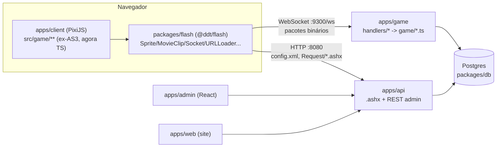

# 2. Arquitetura — as peças e o caminho de um clique

## As 5 peças

| Peça | Papel | Doc fundo |
|---|---|---|
| `apps/client` + `packages/flash` | Cliente (PixiJS + AS3 transpilado para TS + "Flash Player" reimplementado) | [`docs/client-pixi/ARQUITETURA.md`](../client-pixi/ARQUITETURA.md) |
| `apps/game` | Servidor de jogo: pacotes binários (TCP+WS), salas, bolsa, combate | [`docs/GAME-SERVER.md`](../GAME-SERVER.md), [`apps/game/HANDLERS.md`](../../apps/game/HANDLERS.md) |
| `apps/api` | HTTP: `.ashx` byte-compatível (config, templates XML, login) + REST do admin/site | [`docs/API.md`](../API.md) |
| `packages/db` | Schema Drizzle (Postgres), migrações, overlay de traduções | README do pacote |
| `apps/admin` / `apps/web` | Painel admin / site do jogador (React) | READMEs dos apps |

**Princípio nº 1**: o código do jogo (`apps/client/src/game`) é o original — convertido
mecanicamente do AS3, não reescrito tela por tela. Se o comportamento está errado, o bug
quase sempre está no runtime (`packages/flash`) ou no servidor, raramente na lógica do jogo
em si. Ver "Princípios" em [`docs/client-pixi/ARQUITETURA.md`](../client-pixi/ARQUITETURA.md).

**Princípio nº 2**: o protocolo binário cliente↔servidor não muda — é o mesmo do Flash
original, só o transporte foi de TCP pra WebSocket. `packages/protocol` implementa as
mesmas regras dos dois lados (framing, cifra, compressão).

## Ciclo de vida de um clique — exemplo real: comprar na loja

1. **Clique**: jogador clica "Comprar" num item da loja —
   `apps/client/src/game/shop/view/BuySingleGoodsView.ts` (ou `BuyMultiGoodsView.ts` pro
   carrinho). Com `?debug=true`, o log do clique já mostra esse arquivo.
2. **Monta o pacote**: a view chama
   `GameSocketOut.sendBuyGoods(goodsIds, types, colors, dress, skins, places, ...)`
   (`apps/client/src/game/ddt/manager/GameSocketOut.ts:129`), que escreve um
   `PackageOut(ePackageType.BUY_GOODS)` — código **44** — com `count` + por linha
   `[goodsId, type, color, dress, skin, place]` (6600 tem 2 campos extras).
3. **Envia**: `ByteSocket` cifra e manda pelo WebSocket. `?debug=true` mostra
   `↑ enviado 44 (0x002C) BUY_GOODS — N bytes`.
4. **Servidor recebe**: `apps/game` decodifica o frame, acha o handler registrado pro
   código 44 (`apps/game/src/handlers/loja/comprar.ts:187`,
   `r.player(44, "BUY_GOODS", buyGoods)`), chama `buyGoods(ctx, player, pkt)`.
5. **Lê o pacote** na MESMA ordem que o cliente escreveu (`pkt.readInt()`/`readString()`/
   `readBoolean()` — ver `comprar.ts:60-68`), valida contra `game."Shop"`/`Shop_Goods`
   (preço, estoque, nível, vínculo de clã), debita ouro/cupom
   (`PlayerInfo.Money`/`.Gold`), monta os `ItemInfo` e chama `p.addTemplateToBag(...)`
   (`apps/game/src/game/player.ts`) — se não tiver espaço, manda por correio
   (`mailItems`, `bolsa/correio-excedente.ts`).
6. **Grava**: `addTemplateToBag`/`removeMoney` mudam o estado em memória do `GamePlayer` e
   marcam linhas sujas; o `apps/game` persiste no Postgres (`packages/db`, tabelas
   `player."Sys_Users_Goods"`/`"Sys_Users_Detail"`) no próximo ciclo de save (não é por
   pacote — ver `game/player.ts beginChanges/commitChanges` e o save periódico).
7. **Responde**: o handler manda pacote(s) de volta — status da compra (código 44 de
   volta, `[1,3]` sucesso/erro) + atualização de stats/bolsa (`Out.updatePlayerInfo`,
   `Out.gridGoods` etc., `apps/game/src/packets/out.ts`).
8. **Cliente atualiza**: `SocketManager.ts` recebe, despacha
   `CrazyTankSocketEvent` pelo código, a view de bolsa/loja escuta e redesenha a célula
   com o item novo. `?debug=true` mostra `↓ recebido 44 ... ` com o conteúdo.

Esse mesmo roteiro (clique → `GameSocketOut.sendX` → pacote → handler em
`apps/game/src/handlers/**` → `game/*.ts` → `Out.*` → `SocketManager`) vale pra qualquer
ação do jogo. Pra achar os passos de um sistema específico que você não conhece ainda,
veja [`04-receitas/como-achar-qualquer-coisa.md`](./04-receitas/como-achar-qualquer-coisa.md).

## `apps/api` (a outra metade)

Tudo que NÃO é pacote binário de jogo passa por HTTP: `config.xml`, `md5.xml`, listas de
template em XML (`LoadPVEItems.ashx`, `templatealllist.xml`...), login inicial (emite a
`key` de uso único que o cliente manda pro `apps/game`), e toda a API REST do
admin/site. Regra de ouro do `apps/api`: os endpoints `Request/*.ashx` são
**byte-compatíveis** com o C# original (mesma URL, mesmo XML, mesmo zlib) — o cliente Flash
nunca percebe a troca. Ver [`docs/API.md`](../API.md).
